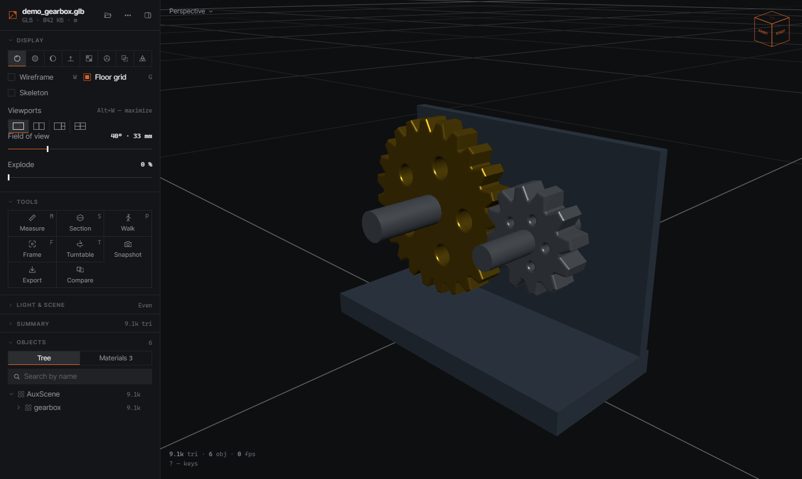
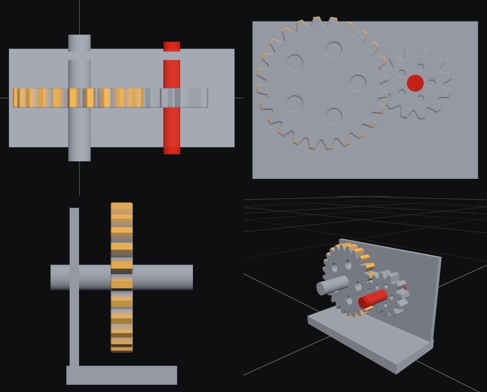

# NP Viewer

**Open almost any 3D file right in the browser — FBX, glTF, STEP, IFC, Rhino 3DM, USD, Alembic and more.** Drop a file and look at it. There's nothing to install and nothing is uploaded: the file is read on your own computer and never leaves it.

🌐 **[Open NP Viewer](https://TTCompanyVision.github.io/np-viewer/)** · ▶ **[Try the demo model](https://TTCompanyVision.github.io/np-viewer/?url=https://raw.githubusercontent.com/TTCompanyVision/np-viewer/main/examples/gearbox.glb)** · [Русский](#русский)



## Why another viewer

Most browser viewers cover one family of formats. NP Viewer opens DCC, CAD, BIM, Rhino, USD and Alembic files in one place, offline, with the same tools for all of them:

| | NP Viewer | Typical web viewer |
|---|---|---|
| FBX, glTF, OBJ, DAE, 3DS, PLY, STL, 3MF | ✅ | ✅ |
| STEP / IGES (CAD), IFC (BIM), Rhino 3DM | ✅ | some |
| USD / USDZ, Alembic (ABC) | ✅ | rarely |
| Works offline, installs as an app, “Open with” | ✅ | rarely |
| Files stay on your computer | ✅ | often uploaded |

## Formats

| Group | Extensions |
|---|---|
| Interchange | FBX, glTF / GLB, OBJ (+MTL and textures), DAE, 3DS, PLY |
| Print | STL, 3MF (including Bambu Studio and Creality projects) |
| CAD | STEP / STP, IGES / IGS |
| BIM | IFC (IFC classes become layers) |
| Rhino | 3DM (Rhino layers become layers) |
| USD | USD, USDA, USDC, USDZ |
| Cache | ABC (Alembic) |

Units are taken from the file (millimetres for STEP/IGES, metres for IFC, `metersPerUnit` for USD, model units for 3DM and 3MF, `UnitScaleFactor` for FBX), so sizes and measurements are real.

## What it can do

- **Display:** file materials, clay, matcap, normals, UV checker, colour by material slot, X-ray, wireframe; wireframe overlay; studio / outdoor / even lighting
- **Navigation:** ViewCube with 26 directions, perspective and orthographic views, 1 / 2 / 4 viewports, walk mode, touch gestures
- **Inspect:** object tree with search, isolate and hide; exploded view; section plane; distance measuring with vertex snapping; statistics
- **Animation** playback for FBX, glTF and Alembic
- **Compare two versions** of a model: the second file is overlaid on the first and coloured by deviation (added material warm, removed cool, within tolerance grey), with max / mean deviation and the share within tolerance
- **Export** what you see to **GLB, FBX** (binary 7.4 with materials and embedded textures), **OBJ** or **STL** (mm, Z up) — a quick converter, all in the browser
- **Open from a link:** `…/np-viewer/?url=<direct link to a model>` — the browser downloads the file straight from where it is hosted (GitHub and Dropbox links are converted to direct ones; glTF `.bin`/textures and OBJ `.mtl` next to it are fetched too). Handy for sharing a model with a colleague without uploading it anywhere new
- **Snapshots** to PNG, including transparent background
- **Offline** and **installable** (PWA); after install it appears in “Open with” for supported files
- Large files are parsed in a background thread, so the page stays responsive
- Interface in **English** and **Russian** (chosen from the browser language, switchable in the ⋯ menu)



## Build

Only Python 3.9+ is needed, no packages:

```bash
python build.py          # → site/
python build.py --zip    # + np-viewer-site.zip
```

`site/` is a plain static folder — put it on any static hosting. To try it locally:

```bash
python -m http.server 8000 -d site
```

Pushing to `main` builds and publishes the site to GitHub Pages (`.github/workflows/pages.yml`). In the repository settings choose **Pages → Source: GitHub Actions** once.

## Layout

| Path | What |
|---|---|
| `index.html` | the app: interface, scene, loaders glue, export, comparison |
| `model_worker.js` | background parsing (Web Worker) |
| `abc_reader.js` | Alembic reader |
| `fbx_writer.js` | binary FBX writer |
| `i18n.js` | English interface |
| `sw.js` | offline cache template |
| `vendor/` | three.js 0.187 and format libraries (pinned copies, see [THIRD_PARTY_LICENSES.md](THIRD_PARTY_LICENSES.md)) |
| `assets/` | icons |
| `examples/` | demo models (made for this project, MIT) |
| `scripts/` | `prepare_vendor.py` (called by the build), `make_icons.py` |

## Limitations

- Point-cache animation in USD shows the first frame only; HDR environments from 3DM are not loaded.
- FBX export writes static meshes (hierarchy, normals, UVs, vertex colours, materials, diffuse textures) — no animation or skinning yet. OBJ export is geometry only.
- glTF files that use the retired `KHR_materials_pbrSpecularGlossiness` extension open without textures.
- Tested in Chrome and Edge. Firefox 114+ and Safari 15+ should work; “Recent files” needs Chrome or Edge.

## License

Own code — [MIT](LICENSE). Bundled libraries keep their own licenses — see [THIRD_PARTY_LICENSES.md](THIRD_PARTY_LICENSES.md).

---

## Русский

**Открывает почти любой 3D-файл прямо в браузере: FBX, glTF, STEP, IFC, Rhino 3DM, USD, Alembic и другие.** Перетащи файл — и смотри. Ничего не нужно ставить и никуда загружать: файл читается на твоём компьютере и не покидает его.

🌐 **[Открыть NP Viewer](https://TTCompanyVision.github.io/np-viewer/)** · ▶ **[Демо-модель](https://TTCompanyVision.github.io/np-viewer/?url=https://raw.githubusercontent.com/TTCompanyVision/np-viewer/main/examples/gearbox.glb)**

**Форматы:** FBX, glTF/GLB, OBJ (+MTL и текстуры), DAE, 3DS, PLY, STL, 3MF, STEP/STP, IGES/IGS, IFC, 3DM, USD/USDA/USDC/USDZ, ABC (Alembic). Единицы берутся из файла, поэтому габарит и замеры — настоящие.

**Возможности:**
- режимы отображения (материалы, глина, matcap, нормали, UV-шахматка, цвет по слотам, рентген, каркас), освещение студия/улица/ровный;
- ViewCube на 26 направлений, перспектива и орто, 1/2/4 вида, режим прогулки, управление касаниями;
- дерево объектов с поиском и изоляцией, разнесение деталей, сечение, рулетка с притяжением к вершинам, статистика;
- анимация FBX, glTF и Alembic;
- **сравнение двух версий модели**: вторая ложится поверх первой и раскрашивается по отклонению (добавлено — тёплым, снято — холодным, в допуске — серым), с максимумом, средним и долей в допуске;
- **экспорт** видимого в GLB, FBX (двоичный 7.4, с материалами и встроенными текстурами), OBJ и STL (мм, Z вверх);
- **открытие по ссылке**: `…/np-viewer/?url=<прямая ссылка на модель>` — файл скачивает сам браузер с того места, где он лежит (ссылки GitHub и Dropbox переводятся в прямые);
- снимки в PNG, в том числе с прозрачным фоном;
- работа без интернета и установка как приложение (PWA), «Открыть с помощью» для поддерживаемых файлов;
- разбор тяжёлых файлов в фоне;
- интерфейс на русском и английском (по языку браузера, переключается в меню ⋯).

**Сборка:** нужен только Python 3.9+.

```bash
python build.py
```

Готовый сайт — в папке `site/`. Пуш в `main` сам собирает и выкладывает сайт на GitHub Pages (один раз в настройках: **Pages → Source: GitHub Actions**).

**Лицензия:** свой код — MIT, библиотеки — под своими лицензиями (см. `THIRD_PARTY_LICENSES.md`).
